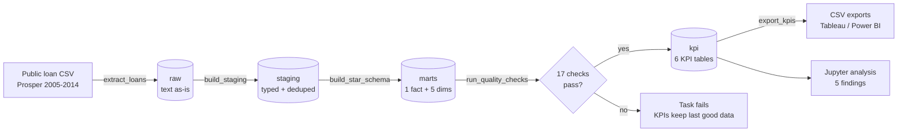
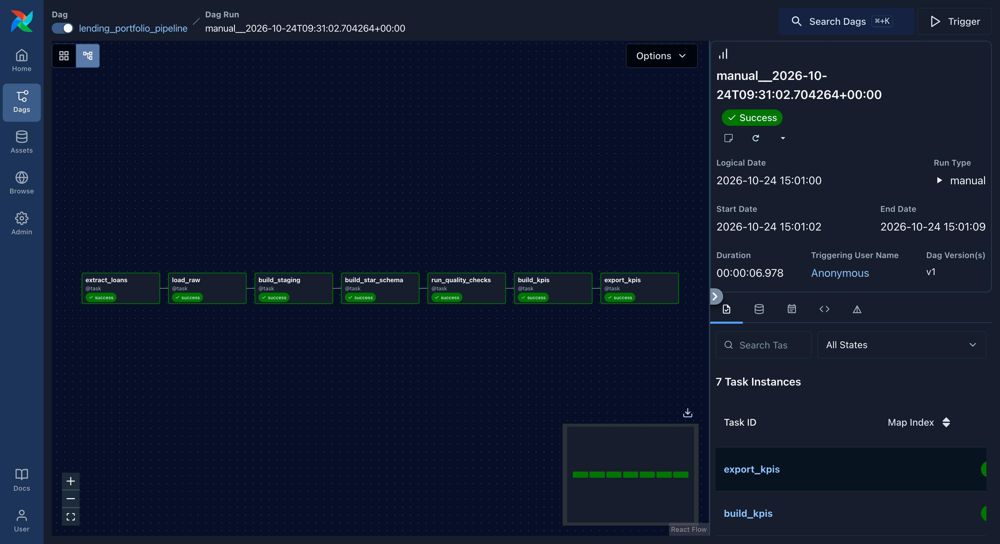
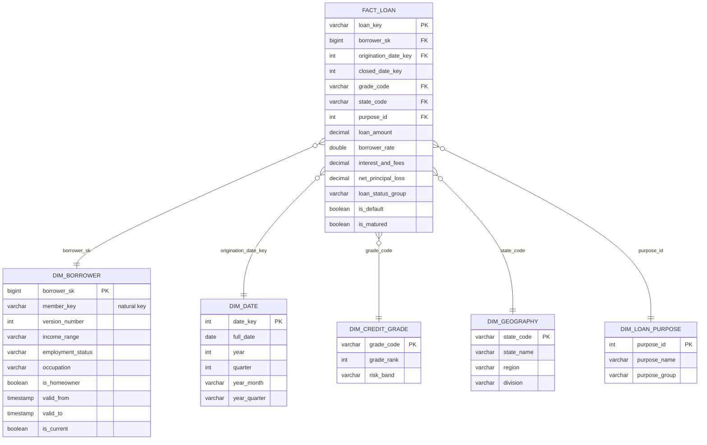
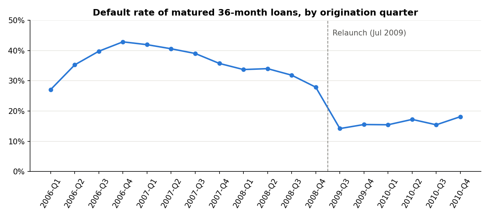
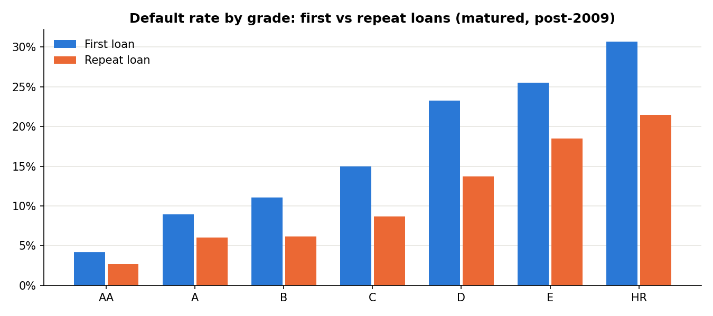

# Loan Portfolio Analytics Pipeline

**Apache Airflow (Astro CLI) · Python · SQL (DuckDB) · Star schema with SCD Type 2 · Data quality checks · Credit-risk analysis**

An end-to-end, daily-scheduled pipeline that turns 113,937 raw peer-to-peer loan records into a
tested star schema and credit-risk KPI tables. It then answers a lending business question with them:

> **Where does the loan portfolio carry the most credit risk, and is that risk priced correctly?**

---

## Architecture



| Layer | What happens | Where |
|---|---|---|
| **Extract** | Download the public CSV (cached), fail fast if expected columns are missing | `include/lending_pipeline/extract.py` |
| **Raw** | Load every column as text, untouched, with a load timestamp | `include/lending_pipeline/load.py` |
| **Staging** | Cast types, rename to snake_case, remove 871 duplicate rows, bucket loan statuses | `include/sql/staging/` |
| **Marts** | Star schema: `fact_loan` + 5 dimensions, including an SCD2 borrower dimension | `include/sql/marts/` |
| **Quality** | 17 SQL checks (15 blocking, 2 warnings), results logged to `audit.dq_results` | `include/lending_pipeline/quality.py` |
| **KPI** | 6 business-ready tables built with CTEs and window functions | `include/sql/kpi/` |
| **Export** | KPI tables → CSV for BI tools | `include/exports/` |

The Airflow DAG ([`dags/lending_portfolio_pipeline.py`](dags/lending_portfolio_pipeline.py)) only
**orchestrates**. All logic sits in plain Python and SQL files, so every step can also run and be
tested without Airflow ([`run_local.py`](run_local.py)).



---

## Data model (star schema)

**Grain of the fact table: one row per loan** (113,066 loans after de-duplication).



| Table | Rows | Notes |
|---|---:|---|
| `fact_loan` | 113,066 | amounts, payments, losses, status flags |
| `dim_borrower` | 99,313 | **SCD Type 2**: 90,831 borrowers; 7,272 have more than one profile version |
| `dim_date` | 3,652 | calendar 2005-2014 |
| `dim_credit_grade` | 9 | AA…HR grades → Prime / Near-prime / Subprime / High risk |
| `dim_geography` | 52 | US state → Census region (from a seed file) + "Unknown" |
| `dim_loan_purpose` | 21 | Prosper's numeric category → name (from a seed file) |

**Why SCD Type 2 for borrowers?** Repeat borrowers often changed income range, job or home ownership
between loans. Type 2 keeps every version with `valid_from` / `valid_to`, and the fact table joins on
`member_key` **plus the listing date between valid_from and valid_to** (a point-in-time join). Each loan
therefore carries the borrower's profile *as it was when they applied*, which is what a credit analysis needs.

---

## Data quality checks

Checks run after the star schema is built and **before** the KPI tables. If any blocking check fails,
the Airflow task fails, so dashboards keep the last good data instead of showing wrong numbers.

| Type | Checks | What it catches |
|---|---|---|
| Volume / reconciliation | raw not empty; staging = distinct raw listings; fact = staging | empty or failed download; bad dedupe; a join that **drops or duplicates** loans |
| Uniqueness | `loan_key` unique in fact; `borrower_sk` unique | duplicate loads, broken surrogate keys |
| Not null | all fact foreign keys populated | loans that would vanish from reports when joined |
| Referential integrity | fact → each of 5 dimensions | "orphan" loans whose grade/state/purpose is missing from a dimension |
| SCD2 integrity | exactly one current row per borrower; no overlapping versions | broken history that would make a loan match 0 or 2 borrower versions |
| Business rules | accepted status values; amount > 0, rate 0-1, term ∈ {12, 36, 60} | upstream schema/value drift |
| Warnings (non-blocking) | net loss ≤ loan amount; defaults have a close date | suspicious but tolerable source issues (found: 2 loans off by cents) |

Tested: injecting one duplicate loan into `fact_loan` fails 2 checks and stops the run.

---

## Key findings

Full analysis: [`analysis/loan_portfolio_analysis.ipynb`](analysis/loan_portfolio_analysis.ipynb).
Default rates are measured on **matured loans only** (full term elapsed), because young loans haven't had time to default.

| # | Finding | Recommendation |
|---|---|---|
| 1 | Volume grew **~13x** from 2010 (USD 27M) to 2013 (USD 357M). No lending from Nov 2008 to Apr 2009 (SEC registration). | Report pre- and post-2009 separately; never compute growth across the gap. |
| 2 | Matured 36-month vintages from 2006-2008 defaulted at **32-43%**; 2009-Q3 to 2010-Q4 vintages at **14-18%**. | Monitor every new vintage against the 2009-2010 baseline at the same loan age. |
| 3 | Default rate rises steadily from AA (3.8%) to HR (25.4%), and lifetime net return rises from 6.6% to 21.2%. Pricing covers losses in every grade. | Re-test high-risk grades on 2011-2012 vintages before growing that volume. |
| 4 | Within the same grade, **repeat borrowers default ~40% less** (grade D: 13.7% vs 23.3%) yet pay almost the same rate (19.2% vs 19.8%). | Add platform repayment history to pricing; retention offers for repeat borrowers. |
| 5 | Borrowers earning USD 100k+ default at **9.6%** vs 18.8% for USD 25-50k (post-2009). | Use smaller limits rather than declines for the lowest income bands. |




---

## How to run

### Option A: Airflow with the Astro CLI (the full pipeline)

Prerequisites: [Docker Desktop](https://www.docker.com/products/docker-desktop/) running, and the
[Astro CLI](https://www.astronomer.io/docs/astro/cli/install-cli) installed
(`brew install astro` on macOS).

```bash
git clone https://github.com/Vaishnavi-2411/loan-portfolio-pipeline.git
cd loan-portfolio-pipeline
astro dev start            # builds the image and starts Airflow at http://localhost:8080
```

In the Airflow UI, unpause **`lending_portfolio_pipeline`** and click **Trigger**. Results appear in
`include/warehouse/lending.duckdb` and `include/exports/*.csv` on your machine, because Astro mounts `include/`.

```bash
astro dev pytest           # DAG integrity tests
astro dev stop
```

### Option B: no Docker (quick local run)

```bash
python -m venv .venv && source .venv/bin/activate
pip install -r requirements-dev.txt
python run_local.py        # same steps, same order, without Airflow (~5 s after download)
jupyter notebook analysis/loan_portfolio_analysis.ipynb
```

### Connect a BI tool
Use the CSVs in [`include/exports/`](include/exports/) (Tableau Public / Power BI / Excel), or query
`include/warehouse/lending.duckdb` directly with the DuckDB CLI or DBeaver.

---

## Project structure

```
├── dags/lending_portfolio_pipeline.py   # Airflow DAG (orchestration only)
├── include/
│   ├── lending_pipeline/                # extract, load, transform, quality (Python)
│   ├── sql/{staging,marts,kpi}/         # numbered SQL files, run in order
│   ├── seeds/                           # reference CSVs (loan purpose, state → region)
│   ├── exports/                         # KPI CSVs for dashboards
│   └── warehouse/                       # DuckDB file (git-ignored, rebuilt by the DAG)
├── analysis/                            # notebook + charts
├── tests/dags/                          # DAG integrity tests
├── run_local.py                         # run the pipeline without Airflow
├── Dockerfile, requirements.txt         # Astro project files
└── docs/INTERVIEW_PREP.md               # design decisions & talking points
```

## Design decisions

- **DuckDB as the warehouse:** a single-file analytical database that needs no server, so it runs on a
  laptop. The SQL is standard (CTEs, window functions), so it ports to Postgres, Snowflake or Databricks
  with minor changes. `max_active_runs=1` because DuckDB allows one writer at a time.
- **Full refresh, idempotent:** every run rebuilds from source with `CREATE OR REPLACE`, so re-running is
  always safe. With an incremental source, the next step would be `MERGE` on `loan_key`, plus an SCD2 merge for borrowers.
- **Raw as text:** a bad value can't break the load; casting is explicit in staging.
- **Matured-loan default rates:** avoids under-stating risk for young loans (see the notebook).

## Data source
Prosper Marketplace loan data (113,937 loans, Nov 2005 - Mar 2014), publicly hosted by Udacity for its
Data Analyst program. It is used here for education only and contains no personal identifiers (borrowers are anonymised keys).
